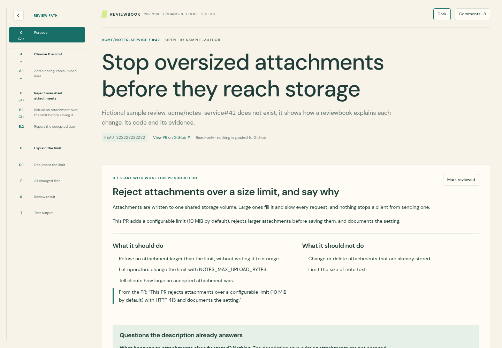

# PR Reviewbook

Turn any GitHub pull request into a reviewbook: an interactive page that walks through every change in a sensible order, explains why each one exists before showing its code, and states what was tested and what was not. Reviewers comment on any code line or diagram box and send their comments back to the bot as one review round.

Start through [PROMPT.md](PROMPT.md) with a pull request link. [BOT.md](BOT.md) holds the instructions the bot follows.



The screenshot shows the bundled sample, `acme/notes-service#42`, a fictional pull request.

## 1. What you get

1. **Purpose first.** What the PR should and should not do, questions its description already answers, and points for the reviewer to decide.
2. **Changes in understanding order.** Steps, optionally grouped. Each opens with the problem it solves, links to the steps it builds on or serves, shows the exact diff with line notes, and ends with what was tested, the result and its limits.
3. **Diagrams where they help.** Boxes mark new, changed, removed or unchanged parts and link to the steps that implement them.
4. **Comments everywhere.** A + on every code line (diff or complete file, original or PR version), every diagram box and arrow, every step and finding. Comments keep the exact file, line, code and revision. Send posts the open ones to the bot's chat; nothing goes to GitHub.
5. **Nothing left out.** A file ledger reconciled with GitHub. Every added and removed line belongs to one step, and every line number is checked against the real files. Generated files stay in the review, labelled with how the bot verified them. Changes with no text diff are listed and flagged if they could not be inspected.
6. **Reviewer state.** Mark steps reviewed, switch light and dark themes, and keep both across visits. Marks made on an earlier revision are flagged.

The page is a static artifact built with PromptQL's `ui-build`, so it needs no VM to view. Building it uses a VM for the scripts.

## 2. Rules that keep the output consistent

1. Build the shipped `app/` unchanged. Do not rewrite or restyle the interface.
2. The only file the bot writes for a pull request is `authored.json`, in the format in [CONTENT_FORMAT.md](CONTENT_FORMAT.md), following [BUILD_GUIDE.md](BUILD_GUIDE.md).
3. The code shown always comes from GitHub through `tools/fetch_pr.py`. Never retype code into `authored.json`.
4. Do not hand over until `tools/assemble.py` passes.
5. Never approve, merge, comment on GitHub, change the pull request or tag anyone unless the person asks.

## 3. Steps

### 3.1 Get the kit

Use a VM with git and Python 3. Fetch the public repository with ordinary HTTPS:

```sh
git clone --depth 1 https://github.com/hasura/promptql-multiplayer-bots.git /workspace/reviewbook-kit
git -C /workspace/reviewbook-kit rev-parse HEAD
```

If the path exists, use a new one. Work in a separate directory per pull request:

```sh
mkdir -p /workspace/review-<repo>-<number> && cd /workspace/review-<repo>-<number>
```

### 3.2 Fetch the pull request

```sh
python3 /workspace/reviewbook-kit/bot-pr-reviewbook/tools/fetch_pr.py https://github.com/OWNER/REPO/pull/NUMBER --out snapshot.json
```

This reads through the person's GitHub connection (`__github`), so private repositories work. If GitHub is not connected, ask them to connect it. For a public repository, `REVIEWBOOK_GITHUB=public` skips the connection.

### 3.3 Understand and test the change

Check out the head revision separately, read the repository's agent instructions, and run its tests and any focused checks. Do not change its code. Keep commands and raw output for the verification section.

### 3.4 Write authored.json

Follow [BUILD_GUIDE.md](BUILD_GUIDE.md) and [CONTENT_FORMAT.md](CONTENT_FORMAT.md). [sample/authored.json](sample/authored.json) is a complete example.

### 3.5 Assemble and check

```sh
python3 /workspace/reviewbook-kit/bot-pr-reviewbook/tools/assemble.py --snapshot snapshot.json --authored authored.json --out content.json --report coverage.json
```

It prints every problem and exits non-zero while any changed line is unassigned or assigned twice, any line number or text differs from GitHub, a file is missing, an explanation is absent, a removed line of code, test or configuration has no note saying why, generated output is marked verified without evidence, or a diagram points at nothing. Fix `authored.json` and rerun. When it passes, store the content on this bot:

```sh
python3 /workspace/reviewbook-kit/bot-pr-reviewbook/tools/assemble.py --snapshot snapshot.json --authored authored.json --out content.json --upload
```

`--upload` stores `reviewbook_content` and creates empty `reviewbook_state` and `reviewbook_comments` artifacts if they do not exist. Existing comments and reviewed marks are kept.

### 3.6 Build the interface

The interface is built in the bot's program runtime, not on the VM. Read each of the four files in `app/` from the checkout and write it, unchanged and with the same name, to the bot's program files: `reviewbook.tsx`, `reviewbook.css`, `reviewbook_actions.py` and `reviewbook.run.json`. Then run `reviewbook.run.json`. It builds the `reviewbook` artifact from `reviewbook.tsx` and `reviewbook.css`. The page loads `reviewbook_content` when it opens and runs `reviewbook_actions.py` to save comments, reviewed marks and the theme, and to send comments.

To refresh the content later, rerun 3.5; the page picks up the new content without rebuilding.

### 3.7 Check and hand over

Open the reviewbook and check it (see [TESTS.md](TESTS.md)). Then hand it over with a short summary of the findings.

## 4. When comments arrive

Send posts the open comments to the bot's chat in one message, with the exact code and revision for line comments. Address them in `authored.json`, rerun 3.5, and reply with what changed. Comments are marked sent, not deleted; reviewers resolve them.

If the pull request gets new commits, fetch again and refresh the review. Comments and reviewed marks from the earlier revision are labelled as such.

## 5. Files

- [BOT.md](BOT.md): the instructions the bot follows.
- [PROMPT.md](PROMPT.md): the starting prompt.
- [BUILD_GUIDE.md](BUILD_GUIDE.md): how to review: why-first explanations, structure, coverage, generated changes, evidence.
- [CONTENT_FORMAT.md](CONTENT_FORMAT.md): the `authored.json` format and the artifacts.
- [tools/fetch_pr.py](tools/fetch_pr.py): fetches the pull request, its files and diffs.
- [tools/assemble.py](tools/assemble.py): checks coverage and builds the content.
- [app/](app/): the interface and the program it runs.
- [sample/](sample/): the fictional example. `snapshot.json` is generated by `tests/make_sample.py`.
- [tests/](tests/) and [TESTS.md](TESTS.md): automated checks and manual acceptance.

## 6. Limits

- One reviewbook per bot. Review each pull request of a multi-repository change in its own bot and link them with `related`.
- Reviews pull requests on GitHub only. GitHub's files API lists at most 3,000 files per pull request.
- The page holds the full original and PR versions of every changed text file, so very large pull requests make a large page.
- Several people can comment at once; each comment is saved separately. Reviewed marks and theme are shared by everyone using the bot.
- The interface depends on the PromptQL artifact host. It is not a standalone website.
