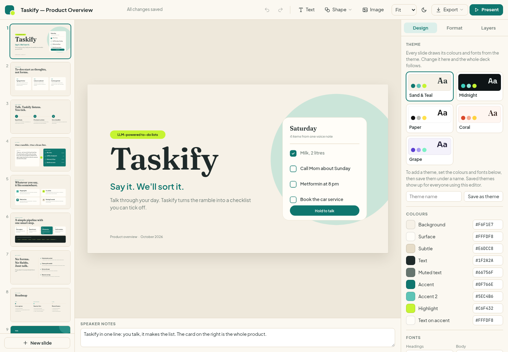
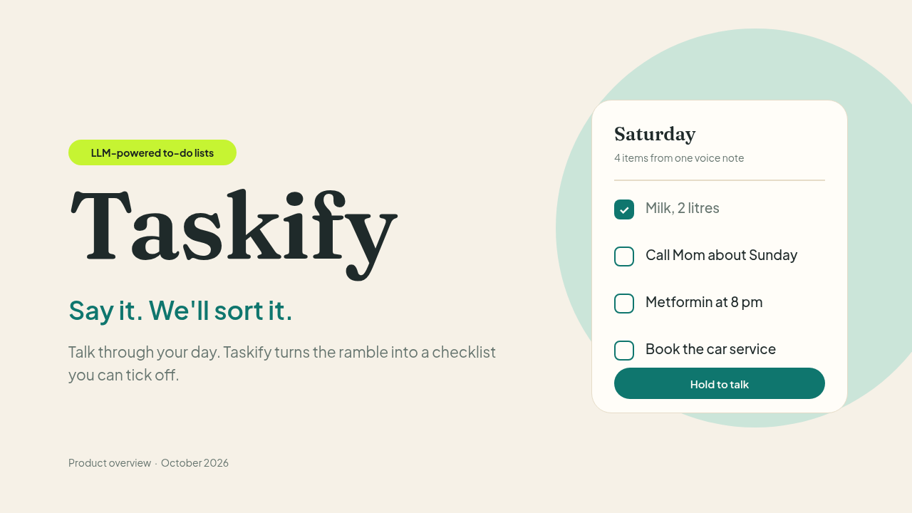

# Presentation Kit: the PromptQL slide editor

A reusable PowerPoint-style editor and fixed-layout deck builder for PromptQL. Start through [PROMPT.md](PROMPT.md), or add it to the bot already working on your task through [BOT.md](BOT.md). Both deploy the same code in [`app/`](app/).

The Taskify sample is a fictional voice-to-checklist app, not a real product.





A v2 VM with systemd, Chrome and uv is required. Creating a deck, editing it and downloading PPTX/PDF/JSON need no SaaS connection. Account copies are optional and use the account of the person who clicks the button.

## 1. What you get

1. A slide editor that runs in the browser: thumbnail rail with a right-click menu (new slide in 5 layouts, duplicate, move, delete), a 1280x720 canvas where every text box, shape and image is a movable, resizable layer, a Design / Format / Layers panel, speaker notes, present mode, autosave with conflict handling, and undo.

2. Themes: 5 presets (Sand & Teal, Midnight, Paper, Coral, Grape) plus user-saved themes shared by everyone using that editor. Colours are theme tokens, so a theme change restyles the whole deck.

3. Exports: editable .pptx (one native shape per layer, with notes), PDF, and the raw deck JSON. "Send to your account" copies the deck into the visitor's own Google Slides (through `__google-drive-v2`) or PowerPoint on OneDrive (through `__microsoft-powerpoint`), using the visitor's credentials.

4. A topic-specific deck of 6 to 12 slides, built from 9 fixed layouts.

## 2. Rules that keep the output identical

1. Deploy the shipped `app/` source unchanged. Do not retype or redesign the editor.

2. The only file you write for a new topic is `deck.py`. It may only call the layout functions in `layouts.py` and `build_deck()`. Never pass coordinates, colours or font sizes; never add raw `T()` or `S()` layers.

3. Never edit `server.py`, `export_pptx.py`, `push.py`, `layouts.py`, `static/*` or `kit/*`. If something is broken, report it rather than patch it.

4. Use the exact commands in section 3, in order. Do not skip QA.

## 3. Steps

### 3.1 Get a VM

The project needs a v2 VM (Ubuntu with systemd, Chrome, uv, node). If the bot has none, use `<provision_vm/>` with the default size.

### 3.2 Put the kit on the VM

Pick a short slug containing lowercase letters, digits and hyphens. Fetch the public repository with ordinary HTTPS; no GitHub connection is needed:

```sh
git clone --depth 1 https://github.com/hasura/promptql-multiplayer-bots.git /workspace/presentation-source
mkdir -p /workspace/<slug>-slides
cp -a /workspace/presentation-source/bot-presentations/app/. /workspace/<slug>-slides/
cd /workspace/<slug>-slides
```

If the checkout path exists, use a new path rather than overwriting work. Record the checkout's commit SHA. Work in a copy of `app/`, not inside the checkout.

### 3.3 Choose names

1. Directory: `/workspace/<slug>-slides` (already created).

2. systemd unit: `<slug>-slides`.

3. App artifact identifier: `<slug>-slides`, at most 32 characters. It becomes part of the app's hostname.

4. Port: 8080. If another app on this VM already uses 8080 (`ss -ltn | grep :8080`), use 8081, 8082 and so on. Never 8888 or 6080.

### 3.4 Write deck.py

Copy `deck_example.py` to `deck.py`, then replace the content following section 4 (content rules) and section 5 (layouts). Keep the imports and the final `build_deck(...)` call. The theme argument is `'sand'` unless the user asks for another preset (`midnight`, `paper`, `coral`, `grape`).

### 3.5 Build, install, check

```sh
cd /workspace/<slug>-slides
python3 deck.py                          # writes data/seed.json
sh kit/setup.sh <slug>-slides <port>     # venv, systemd unit, waits for /readyz
uv run kit/qa.py <port>                  # renders slides, checks overflow and exports
```

`setup.sh` must end with `readyz=204 enabled=enabled active=active`. `qa.py` must end with `QA passed`.

If QA fails, shorten the offending text in `deck.py` (the message names the slide and layer), then rebuild with the reseed flag so the new seed replaces the old deck:

```sh
python3 deck.py && RESEED=1 sh kit/setup.sh <slug>-slides <port> && uv run kit/qa.py <port>
```

Only use `RESEED=1` before handing the editor over. After a user has edited the deck, it would wipe their work.

### 3.6 Look at the slides

QA passing is necessary, not sufficient. Store `qa/contact.png` as a hidden file artifact and preview it, then check each slide against section 4: one idea, nothing cramped, nothing that reads as filler. Fix and rebuild as in 3.5.

```sh
curl -sSf -X PUT "$PROMPTQL_PLATFORM_API_URL/v1/artifacts/threads/$PROMPTQL_THREAD_ID/qa-contact" \
  -H "Authorization: Bearer $PROMPTQL_USER_JWT" -H "X-PromptQL-Artifact-Type: file" \
  -H "X-PromptQL-Artifact-File-Name: contact.png" -H "X-PromptQL-Artifact-Title: Slide QA" \
  -H "X-PromptQL-Artifact-Hidden: true" -H "Content-Type: image/png" --data-binary @qa/contact.png
```

### 3.7 Publish

```sh
sh kit/publish.sh <slug>-slides "<Topic> Slides" <port>
```

The title is one line of plain ASCII. The declaration is version 2, kind web, readiness `/readyz`, and asks for the two integrations used by "Send to your account", so each visitor consents once.

### 3.8 Reply

Tell the user the editor is ready and reference the app artifact. Mention: everything is editable, theme switching is in the Design tab, export is in the top bar, and "Send to your account" needs Google Drive or Microsoft PowerPoint connected for whoever clicks it.

## 4. Content rules

1. One idea per slide. The heading states the idea as a short claim in sentence case ("To-dos start as thoughts, not forms"), not a topic label ("Problems").

2. Default structure for a product or project: title, problem, how it works, example (before and after), uses, how it is built, why it wins, roadmap, closing. For other topics, map each slide's purpose onto the layout catalogue in section 5. Layouts may be repeated or skipped; keep 6 to 12 slides; always start with `title_slide` and end with `closing`.

3. Respect every character limit in the layout's docstring (repeated in section 5). Limits exist so text fits its box; QA fails if it does not.

4. Section labels are ALL CAPS and at most about 40 characters. Headings are at most 2 lines; split lines with `\n` at a natural phrase break.

5. Card and step bodies are one plain sentence. No bullet characters inside cards; bullets only in `roadmap3`, which adds them itself.

6. Every slide has speaker notes: one or two sentences saying what to emphasise.

7. Use real content from the user and the wiki. Do not invent numbers, customers or quotes; if the topic needs figures you do not have, ask or leave the claim qualitative.

8. Curly quotes (“ ”), the ellipsis (…) and the middle dot (·) are fine; the example uses them.

## 5. Layout catalogue

All layouts share one grid: canvas 1280x720, left margin 96, content width 1088 (right edge 1184), section label at y 92, heading at y 124. The design uses: one accent colour, generous whitespace, strict alignment, two typefaces (heading and body; mono only for code), strong contrast.

1. `title_slide(title, tagline, blurb, tag, footer, card_title, card_sub, items, button, notes)`. Opening slide. Title up to 13 characters reads best (size steps down automatically at 10 and 14 characters); tagline up to 30; blurb up to 110; tag pill up to 40; footer like "Product overview  ·  October 2026". The right-hand card is a mini product preview: card_title up to 18, card_sub up to 32, items are 2 to 4 `(text up to 22, done)` rows, button up to 22.

2. `cards3(label, heading, cards, notes)`. Three parallel points (problems, pillars, reasons). Each card is `(title up to 22, body up to 110)`.

3. `steps3(label, heading, steps, notes)`. A three-step process. Each step is `(title up to 20, body up to 90)`.

4. `before_after(label, heading, left_label, quote, right_label, rows, notes)`. A concrete example of the transformation: raw input on the left, the result on the right. Heading is one line up to 30; quote up to 220; rows are up to 4 `(text up to 24, tag up to 12)`.

5. `grid4(label, heading, items, notes)`. Four use cases or segments. Each item is `(letter, title up to 24, body up to 95)`; the letter is the item's initial.

6. `pipeline4(label, heading, stages, code_caption, code, hot, notes)`. A four-stage flow with one highlighted stage (`hot`, 0 to 3, default 2). Each stage is `(title up to 18, body up to 60)`. The dark code card is optional: `code` is one or two lines up to 85 characters, `code_caption` up to 80.

7. `statement(label, statement, sub, feats, notes)`. A bold three-line claim on the left (lines up to 12 characters, split with `\n`), sub up to 60, and four features on the right, each `(title up to 30, body up to 65)`.

8. `roadmap3(label, heading, phases, notes)`. Three phases on a timeline. Heading is one line. Each phase is `(PHASE up to 20 in caps, title up to 20, [three bullets up to 32])`.

9. `closing(wordmark, line, cta, footer, notes)`. Final slide on the accent background. Line is 2 lines up to 18 characters each; cta up to 55.

## 6. How it fits together

1. `layouts.py` turns `deck.py` into `data/seed.json` (title, theme, slides; ids `s{n}` and `s{n}e{m}`). Text on accent fills is switched to the `onAccent` token automatically so every theme stays legible.

2. `server.py` (Python standard library, port from `PORT`) serves the editor, keeps the live deck in `data/deck.json` with a revision number (saves send `baseRev`; a stale save gets 409), keeps the last 300 revisions in `data/history`, saved themes in `data/themes.json`, uploads in `data/uploads`. `/readyz` answers 204.

3. `static/render.js` is the single renderer used by the editor, thumbnails, present mode and the `/print` page; PDF export prints `/print` with headless Chrome.

4. `export_pptx.py` builds the .pptx with python-pptx (1 px = 9525 EMU, font pt = px x 0.75). Fonts are named, not embedded.

5. `push.py` handles "Send to your account" through `$PROMPTQL_PLATFORM_API_URL/v1/integration/...` with the visitor's `X-PromptQL-Visitor-Token`, never the bot's JWT. Google Slides: uploads the .pptx to Drive with target type `application/vnd.google-apps.presentation`, so Drive converts it. PowerPoint: PUTs the .pptx into OneDrive under `PromptQL Slides/`. Both are one-time copies.

6. `kit/setup.sh` writes the systemd unit with `PROMPTQL_PLATFORM_API_URL` baked in, because systemd does not inherit the VM shell environment. The unit is enabled, so the editor comes back after the VM idles and cold-boots.

## 7. Troubleshooting

1. `setup.sh` says the port is in use: pick the next port and use it for setup, QA and publish.

2. `readyz` never reaches 204: `journalctl -u <unit> -n 50` shows the Python error.

3. "Send to your account" says an integration is not connected: the visitor must connect Google Drive or Microsoft PowerPoint in Settings, then retry. This is a 502 from the proxy and is not an outage.

4. The deck did not change after rebuilding `seed.json`: you forgot `RESEED=1`.

5. Known limits: no grouping, tables, charts or animations. Google Slides conversion may alter typography, transparency and image corners; live conversion fidelity is not verified. PowerPoint substitutes fonts that are not installed.


## 8. Tests and limits

Run from `app/` after installing dependencies:

```sh
.venv/bin/python -m unittest discover -s ../tests -v
uv run kit/qa.py <port>
```

The unit and local HTTP tests cover the nine sample layouts, editable PPTX layers and notes, optimistic saves, theme validation, uploads, missing visitor-token refusal, and integration routing with mocked network calls. See [TESTS.md](TESTS.md) for coverage and manual checks.

Google Slides and OneDrive copies are opt-in and are not live synchronization. Real account writes, resumable uploads and conversion fidelity are not covered by the automated suite. Fonts load from Google Fonts and are named, not embedded in PPTX; offline machines may substitute them.

Participants share the deck, uploads and saved themes. Autosave detects stale revisions; it does not merge simultaneous edits character-by-character. This reference app runs behind PromptQL's app gateway, not as an independently public hosting service.

Generated decks, uploads, history, virtual environments and QA outputs are not versioned. Never commit credentials or visitor tokens.

## 9. Product-wiki integration

A Bot Factory entry enables discovery but does not change ordinary presentation requests in an existing bot. After merge and review, the PromptQL product wiki can link from **Slide Presentations** to this package, explain when to use the editor and retain the slide-design guidance. That follow-up belongs in `promptql-cloud` with product-wiki review. The editor remains an ordinary app artifact. No core system-instruction change is included here.
